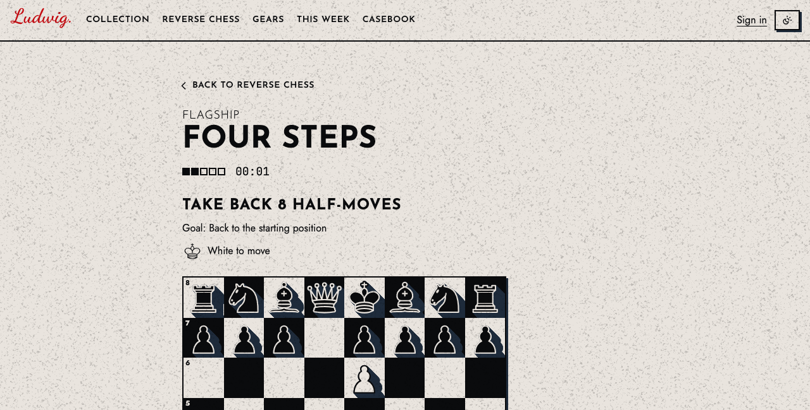
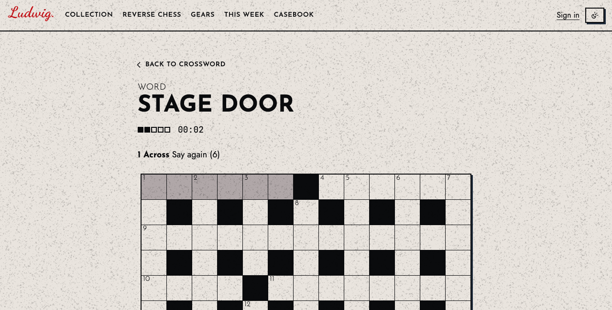
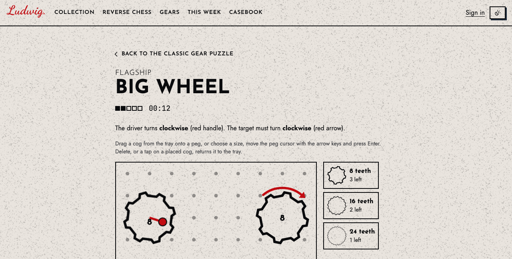
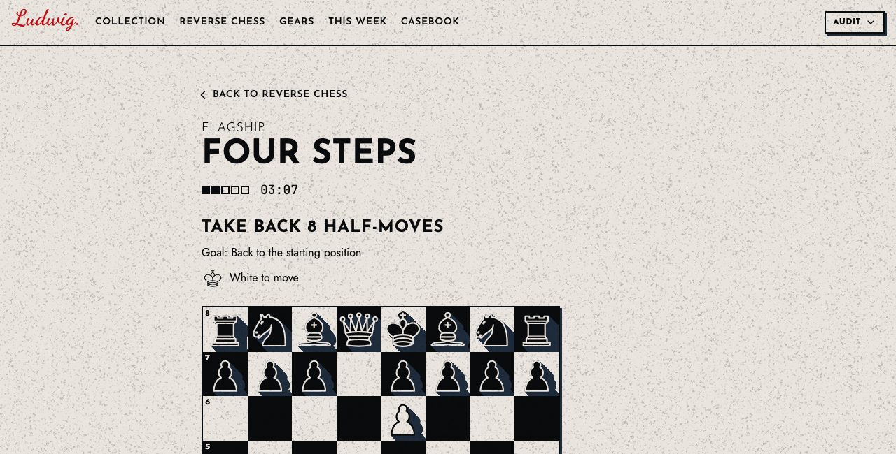

# Desktop solve layout audit (T169)

Audit of the solve page (`/puzzles/[type]/[slug]`) on a desktop, for every type in `src/puzzles/registry.ts`. It is the specification for T170 (`docs/tickets/T170-desktop-board-and-panel-layout.md`). Nothing under `src/`, `content/` or `e2e/` was changed.

- **Script:** `scripts/dev/audit-desktop-layout.mts`. Headless Chromium with a fine pointer (so the `touch` variant never applies), against `pnpm build && pnpm start --port 3169`. Modes: default (every type at both sizes, open and solved, with screenshots), `--chrome` (the chrome blocks), `--grown` (the growing-panel cases) and `--sweep` (every published puzzle at 1280×650, no screenshots). Output and screenshots go to `.verification/T169/` (git-ignored); four are copied to `docs/research/desktop-solve-layout/` and embedded in section 11.
- **Viewports:** 1440×800 and 1280×650. "Fits" means Check, Reset and the status line end inside the viewport at `scrollY` 0.
- **Representative puzzle:** the first published puzzle of the type in volume order (`volumes.sort`, then `volume_position`). Reverse Chess has two rows, the first `last_move` and the first `unwind`. The content has no proof-game (Mode C) puzzle and Mode D is its own type, `rota`, so there are 35 targets for the registry's 34 types.
- **Solved state:** measured signed in, with a completed `attempts` row inserted for the puzzle, so the page opens solved with no epilogue. An epilogue (nonogram caption, odd-one-out explanation, rota timeline) adds height; see section 3.

## 1. Headline findings

1. **Every type overflows today, at both sizes.** The smallest page (anagram) is 12px over at 1440×800 and 162px over at 1280×650. The worst are the logic grid (1182 and 1332px over), the crossword (970 and 1120), knights and knaves (688 and 838), Reverse Chess `unwind` (756 and 906) and the `gears` page (624 and 774, excluded).
2. **The chrome causes most of it.** Above the solver sit 310px (site header 66, `main` padding 48, title block 172, gap 24) and below it 112px (gap 24, Check and Reset 40, gap 24, status line 24), before the solved footer. That is 422px of a 650px viewport, leaving 228px (378px at 800) for the puzzle. The recommendation cuts it to 164px.
3. **T170's starting list was wrong in both directions.** Several types in it have no board (`acrostic`, `knights-knaves`, `napkin-maths`, `word-ladder`, the ciphers). The types it called "probably board-only" (`nonogram`, `norinori`, `star-battle`, `circle9`, `railroad`, `reflections`) cannot fit in one column at 1280×650: with a one-line brief, Check and Reset and the status line under it, a one-column board gets about 314px. They go in the shared board-and-panel shell, with a panel that holds only the brief and the chrome. Only `anagram` and `odd-one-out` fit in one column once the chrome is compact.
4. **Boards are small today because of caps, not height.** `CellGrid` already sizes cells as `min(container width / cols, --solver-height / rows)`, but callers cap cells at `cellRem` (3.5rem by default), `DigitGrid` wraps in `max-w-xl`, `RegionMarkGrid` caps at `cols * 3.5rem` and the chess board is `max-w-lg` (512px). T170 has to lift those caps to reach the sizes in section 7.
5. **`word-search` also splits in two already** (`md:flex-row`), which T170 did not list.

## 2. Measurements

One row per type and viewport. Doc height is `document.documentElement.scrollHeight`; overflow is that minus the viewport height; "(below)" marks a bottom edge past the fold. The solved columns come from the same page opened with a completion (the stamp's bottom edge is what counts). The sweep and the other modes are summarised below the table.

| Type | Puzzle | Viewport | Doc height | Overflow | Board W×H | Check bottom | Status bottom | Solved: doc height | Solved: stamp bottom |
|---|---|---|---|---|---|---|---|---|---|
| acrostic | cold-coffee | 1440x800 | 1056 | 256 | none | 862 (below) | 910 (below) | 1376 | 1130 (below) |
| acrostic | cold-coffee | 1280x650 | 1056 | 406 | none | 862 (below) | 910 (below) | 1376 | 1130 (below) |
| anagram | crossing-point | 1440x800 | 812 | 12 | none | 618 | 666 | 1132 | 886 (below) |
| anagram | crossing-point | 1280x650 | 812 | 162 | none | 618 | 666 (below) | 1132 | 886 (below) |
| book-cipher | bowerbird-nest | 1440x800 | 1352 | 552 | 648×712 | 1158 (below) | 1206 (below) | 1672 | 1426 (below) |
| book-cipher | bowerbird-nest | 1280x650 | 1352 | 702 | 648×712 | 1158 (below) | 1206 (below) | 1672 | 1426 (below) |
| caesar | lamp-oil | 1440x800 | 1040 | 240 | none | 846 (below) | 894 (below) | 1360 | 1114 (below) |
| caesar | lamp-oil | 1280x650 | 1040 | 390 | none | 846 (below) | 894 (below) | 1360 | 1114 (below) |
| cctv-maze | backs-path | 1440x800 | 1272 | 472 | 480×480 | 1078 (below) | 1126 (below) | 1592 | 1346 (below) |
| cctv-maze | backs-path | 1280x650 | 1272 | 622 | 480×480 | 1078 (below) | 1126 (below) | 1592 | 1346 (below) |
| chess-problem | a-quiet-word | 1440x800 | 1416 | 616 | 512×512 | 1222 (below) | 1270 (below) | 1736 | 1490 (below) |
| chess-problem | a-quiet-word | 1280x650 | 1416 | 766 | 512×512 | 1222 (below) | 1270 (below) | 1736 | 1490 (below) |
| circle9 | false-trail | 1440x800 | 1172 | 372 | 504×504 | 978 (below) | 1026 (below) | 1492 | 1246 (below) |
| circle9 | false-trail | 1280x650 | 1172 | 522 | 504×504 | 978 (below) | 1026 (below) | 1492 | 1246 (below) |
| crossword | stage-door | 1440x800 | 1770 | 970 | 692×692 | 1576 (below) | 1624 (below) | 2090 | 1844 (below) |
| crossword | stage-door | 1280x650 | 1770 | 1120 | 692×692 | 1576 (below) | 1624 (below) | 2090 | 1844 (below) |
| detective-scene | cambridge-night | 1440x800 | 1259 | 459 | 700×467 | 1065 (below) | 1113 (below) | 1579 | 1333 (below) |
| detective-scene | cambridge-night | 1280x650 | 1259 | 609 | 700×467 | 1065 (below) | 1113 (below) | 1579 | 1333 (below) |
| fillomino | borrowed-time | 1440x800 | 1187 | 387 | 543×543 | 993 (below) | 1041 (below) | 1507 | 1261 (below) |
| fillomino | borrowed-time | 1280x650 | 1187 | 537 | 543×543 | 993 (below) | 1041 (below) | 1507 | 1261 (below) |
| futoshiki | balance-sheet | 1440x800 | 1141 | 341 | 477×477 | 947 (below) | 995 (below) | 1461 | 1215 (below) |
| futoshiki | balance-sheet | 1280x650 | 1141 | 491 | 477×477 | 947 (below) | 995 (below) | 1461 | 1215 (below) |
| gear-train | big-wheel | 1440x800 | 1080 | 280 | 504×336 | 886 (below) | 934 (below) | 1400 | 1154 (below) |
| gear-train | big-wheel | 1280x650 | 1080 | 430 | 504×336 | 886 (below) | 934 (below) | 1400 | 1154 (below) |
| gears | cold-open | 1440x800 | 1424 | 624 | 576×576 | 1230 (below) | 1278 (below) | 1744 | 1498 (below) |
| gears | cold-open | 1280x650 | 1424 | 774 | 576×576 | 1230 (below) | 1278 (below) | 1744 | 1498 (below) |
| kakuro | blind-sum | 1440x800 | 1234 | 434 | 507×570 | 1040 (below) | 1088 (below) | 1554 | 1308 (below) |
| kakuro | blind-sum | 1280x650 | 1234 | 584 | 507×570 | 1040 (below) | 1088 (below) | 1554 | 1308 (below) |
| keyword | blotting-paper | 1440x800 | 1040 | 240 | none | 846 (below) | 894 (below) | 1360 | 1114 (below) |
| keyword | blotting-paper | 1280x650 | 1040 | 390 | none | 846 (below) | 894 (below) | 1360 | 1114 (below) |
| knights-knaves | by-the-fire | 1440x800 | 1488 | 688 | none | 1294 (below) | 1342 (below) | 1808 | 1562 (below) |
| knights-knaves | by-the-fire | 1280x650 | 1488 | 838 | none | 1294 (below) | 1342 (below) | 1808 | 1562 (below) |
| logic-grid | cold-frame | 1440x800 | 1982 | 1182 | 668×674 | 1788 (below) | 1836 (below) | 2302 | 2056 (below) |
| logic-grid | cold-frame | 1280x650 | 1982 | 1332 | 668×674 | 1788 (below) | 1836 (below) | 2302 | 2056 (below) |
| napkin-maths | bar-tab | 1440x800 | 1024 | 224 | none | 830 (below) | 878 (below) | 1344 | 1098 (below) |
| napkin-maths | bar-tab | 1280x650 | 1024 | 374 | none | 830 (below) | 878 (below) | 1344 | 1098 (below) |
| nonogram | blind-spot | 1440x800 | 1250 | 450 | 513×538 | 1056 (below) | 1104 (below) | 1570 | 1324 (below) |
| nonogram | blind-spot | 1280x650 | 1250 | 600 | 513×538 | 1056 (below) | 1104 (below) | 1570 | 1324 (below) |
| norinori | cold-case | 1440x800 | 1116 | 316 | 448×448 | 922 (below) | 970 (below) | 1436 | 1190 (below) |
| norinori | cold-case | 1280x650 | 1116 | 466 | 448×448 | 922 (below) | 970 (below) | 1436 | 1190 (below) |
| odd-one-out | concert-programme | 1440x800 | 868 | 68 | none | 674 | 722 | 1188 | 942 (below) |
| odd-one-out | concert-programme | 1280x650 | 868 | 218 | none | 674 (below) | 722 (below) | 1188 | 942 (below) |
| pictogram-cipher | chalk-marks | 1440x800 | 1230 | 430 | none | 1036 (below) | 1084 (below) | 1550 | 1304 (below) |
| pictogram-cipher | chalk-marks | 1280x650 | 1230 | 580 | none | 1036 (below) | 1084 (below) | 1550 | 1304 (below) |
| railroad | branch-line | 1440x800 | 970 | 170 | 268×258 | 776 | 824 (below) | 1290 | 1045 (below) |
| railroad | branch-line | 1280x650 | 970 | 320 | 268×258 | 776 (below) | 824 (below) | 1290 | 1045 (below) |
| reflections | double-take | 1440x800 | 1200 | 400 | 361×309 | 1006 (below) | 1054 (below) | 1520 | 1275 (below) |
| reflections | double-take | 1280x650 | 1200 | 550 | 361×309 | 1006 (below) | 1054 (below) | 1520 | 1275 (below) |
| reverse-chess:last_move | bishop-taken | 1440x800 | 1424 | 624 | 512×512 | 1230 (below) | 1278 (below) | 1744 | 1498 (below) |
| reverse-chess:last_move | bishop-taken | 1280x650 | 1424 | 774 | 512×512 | 1230 (below) | 1278 (below) | 1744 | 1498 (below) |
| reverse-chess:unwind | four-steps | 1440x800 | 1556 | 756 | 512×512 | 1362 (below) | 1410 (below) | 1876 | 1630 (below) |
| reverse-chess:unwind | four-steps | 1280x650 | 1556 | 906 | 512×512 | 1362 (below) | 1410 (below) | 1876 | 1630 (below) |
| rota | canteen-queue | 1440x800 | 1312 | 512 | 388×388 | 1118 (below) | 1166 (below) | 1632 | 1386 (below) |
| rota | canteen-queue | 1280x650 | 1312 | 662 | 388×388 | 1118 (below) | 1166 (below) | 1632 | 1386 (below) |
| sightlines | chapel-aisle | 1440x800 | 1252 | 452 | 432×432 | 1058 (below) | 1106 (below) | 1572 | 1326 (below) |
| sightlines | chapel-aisle | 1280x650 | 1252 | 602 | 432×432 | 1058 (below) | 1106 (below) | 1572 | 1326 (below) |
| spot-difference | bridge-of-sighs | 1440x800 | 1115 | 315 | 596×423 | 921 (below) | 969 (below) | 1435 | 1189 (below) |
| spot-difference | bridge-of-sighs | 1280x650 | 1115 | 465 | 596×423 | 921 (below) | 969 (below) | 1435 | 1189 (below) |
| star-battle | double-bill | 1440x800 | 1092 | 292 | 448×448 | 898 (below) | 946 (below) | 1412 | 1166 (below) |
| star-battle | double-bill | 1280x650 | 1092 | 442 | 448×448 | 898 (below) | 946 (below) | 1412 | 1166 (below) |
| sudoku | back-page | 1440x800 | 1162 | 362 | 498×498 | 968 (below) | 1016 (below) | 1482 | 1236 (below) |
| sudoku | back-page | 1280x650 | 1162 | 512 | 498×498 | 968 (below) | 1016 (below) | 1482 | 1236 (below) |
| troix | cross-and-circle | 1440x800 | 1177 | 377 | 477×477 | 983 (below) | 1031 (below) | 1497 | 1251 (below) |
| troix | cross-and-circle | 1280x650 | 1177 | 527 | 477×477 | 983 (below) | 1031 (below) | 1497 | 1251 (below) |
| word-ladder | coin-toss | 1440x800 | 1174 | 374 | none | 980 (below) | 1028 (below) | 1494 | 1248 (below) |
| word-ladder | coin-toss | 1280x650 | 1174 | 524 | none | 980 (below) | 1028 (below) | 1494 | 1248 (below) |
| word-search | long-vacation | 1440x800 | 983 | 183 | 379×379 | 789 | 837 (below) | 1303 | 1057 (below) |
| word-search | long-vacation | 1280x650 | 983 | 333 | 379×379 | 789 (below) | 837 (below) | 1303 | 1057 (below) |
| word-wheel | dead-hours | 1440x800 | 1124 | 324 | 384×384 | 930 (below) | 978 (below) | 1444 | 1198 (below) |
| word-wheel | dead-hours | 1280x650 | 1124 | 474 | 384×384 | 930 (below) | 978 (below) | 1444 | 1198 (below) |

### Largest puzzle of each type (sweep, 1280×650)

`--sweep` opened all 265 published puzzles except spot-difference at 1280×650. Doc height of the largest, against the representative:

| Type | Largest | Doc height | Overflow | Note |
|---|---|---|---|---|
| crossword | `fine-print` (15×15 cryptic, 36 clues) | 1771 | 1121 | rep `stage-door` 1770; the clue lists scroll inside `max-h-80` today, so the height barely changes. The Across list alone is 576px (`scrollHeight`), both lists about 1150px |
| logic-grid | `manifest` (4 categories × 5, 15 clues) | 2378 | 1728 | rep `cold-frame` is 1982 |
| knights-knaves | `night-ferry` (5 characters) | 1692 | 1042 | rep `by-the-fire` is 1488 |
| reverse-chess `unwind` | `the-long-walk` (14 plies) | 1556 empty, 1944 with all 14 plies entered | 1294 | the chain adds 28px a ply (`--grown`: 14 `retro-step` items) |
| gear-train | `last-departure` (12×12, 3 cog sizes) | 1293 | 643 | rep `big-wheel` 1080 |
| cctv-maze | `labyrinthos` (12×12) | 1368 | 718 | 576px board |
| kakuro | `cold-tally` (10×9) | 1267 | 617 | |
| nonogram | `bumps-in-the-night` (15×15) | 1323 | 673 | |
| sightlines | `long-gallery` (11×11, 5 observers) | 1372 | 722 | |
| railroad | `buffer-stop` (10×10) | 1211 | 561 | rep `branch-line` 5×5 is 970 |
| reflections | `vanishing-point` (9×8) | 1356 | 706 | |
| word-search | `opening-gambit` / `wound-up` (12×10, 10 words) | 1057 | 407 | |

Every other type's puzzles differ by under 200px from the representative one.

## 3. The solve chrome's cost

Measured on Reverse Chess `unwind` (`--chrome`). The figures are the same at both sizes because nothing in the chrome depends on the viewport; the column is 704px wide.

| Block | Height | Where it is today |
|---|---|---|
| Site header (`SiteHeader`) | 66 | above `main`, in flow, not sticky |
| `main` padding top | 48 | `py-12` |
| Title block (`<header>` in `SolveBoard`) | 172 | back link 44, gap 12, `Credit` 76 (small line 28, large line 48), gap 12, difficulty badge and timer row 28 |
| Gap before the solver | 24 | `gap-6` in the section |
| **Above the solver** | **310** | |
| Gap, then Check and Reset | 24 + 40 | |
| Gap, then status line (`role=status`, `min-h-6`: 24 even when empty) | 24 + 24 | |
| **Below the solver, before the footer** | **112** | |
| `main` padding bottom | 48 | |
| Solved footer (`data-testid=solved-footer`) | 296 (+24 gap) | stamp hole 264 plus 2 × 16 padding, plus the epilogue |
| Site footer (`SiteFooter`) | 98 | after `main`, 1458px down |

So at 1440×800 the solver gets 800 − 310 − 112 = 378px and at 1280×650 only 228px, before the solved footer pushes everything further. Under `touch` the chrome hides the back-link text, the `Credit` top line and the badge, puts title, timer and menu on one row and moves Check and Reset into the bottom slot.

### Recommendation: a one-row title bar over both columns

Use the touch header's shape on desktop (`lg` and up, fine pointer only).

| Block | Recommended placement | Height |
|---|---|---|
| Site header | unchanged | 66 |
| `main` padding top and bottom | 12 each (was 48) | 12 + 12 |
| Title bar | one row across both columns: chevron back link (44px target, `aria-label` kept), the `Credit` large line only on one line (top line hidden as under touch), difficulty badge, timer, `PuzzleMenu` | 62 (44 + 2 × 8 padding + 2 border, as the touch header) |
| Gap under the bar | | 12 |
| Check and Reset, status line, solved footer | at the foot of the panel, not under the board | 40, 24, 248 |

That leaves 66 + 12 + 62 + 12 = 152px above the columns and 12px below: **a board column height budget of `100dvh − 164px`, which is 636px at 1440×800 and 486px at 1280×650.** The panel gets the same height.

- Check and Reset (40), the status line (24) and two 12px gaps take 88px of the panel, leaving 548px (800) or 398px (650) for the type's own content.
- **Solved footer in the panel:** use the touch stamp size (`--hole-size` 216px, so the footer is 248px, not 296) and let it replace the Check and Reset row (both are disabled once solved). The status line stays. That leaves 636 − 248 − 24 − 24 = 340px (800) and 190px (650) above it for the scrolling content, and the stamp and time are always inside the viewport. An epilogue (the rota timeline is about 9 lines or 216px; the nonogram caption and odd-one-out explanation are a sentence or two) goes inside the footer, which takes the touch rules (`max-h`, `overflow-y-auto`).
- Without the compact bar the board would get 800 − 310 − 160 = 330px at 1440×800 and 650 − 310 − 160 = 180px at 1280×650 (160 is the 112px below the solver plus the 48px `main` padding). The recommendation is not optional.
- The site footer (98px) stays below the fold; the ticket allows that.

### Why not one column for the grid-only types

One column at 1280×650 under the same bar: 650 − 152 − 84 (a one-line brief, 72 plus gap) − 52 (Check and Reset plus gap) − 36 (status plus gap) − 12 = 314px for the board, under the 400px floor. Without a brief it is 398px, still under. So the grid-only types take the shared shell with a rail (section 4).

## 4. Groups

`panel`: board left, panel right. `board-only`: one column, the compact bar, board sized by the viewport height. `excluded`: layout unchanged. Fixed by the user (2026-11-23): `gears` and `spot-difference` are `excluded`; `gear-train`, `reverse-chess` (both modes), `chess-problem` and `crossword` are `panel`; every other type with many annotations or controls is `panel`.

Where a type has no board, the "board" is its main sheet or list (what the player looks at) and the panel holds the inputs.

| Type | Group | Reason |
|---|---|---|
| `reverse-chess` | panel | fixed by the user; the 512px board plus heading, chain, ply choices and notation toggle are 750px+ stacked |
| `chess-problem` | panel | fixed by the user; board plus the line, promotion choice and notation toggle |
| `gear-train` | panel | fixed by the user; instructions, cog tray and pegboard |
| `crossword` | panel | fixed by the user; the clue lists, Check cell and Reveal cell beside the grid |
| `kakuro` | panel | grid 507×570 plus the Hints toggle and combination readout |
| `sudoku` | panel | Notes toggle, Clear notes and the notes status line |
| `futoshiki` | panel | same `DigitGrid` controls |
| `logic-grid` | panel | 668×674 grid plus the case notes and up to 15 clues; the worst page |
| `rota` | panel | already splits at `lg`; incident sheet, pinned workers, clues, stack and accusation are all panel content |
| `sightlines` | panel | brief sheet, instructions, observer list and count |
| `cctv-maze` | panel | brief, instructions, Reveal cameras and Restart path buttons |
| `detective-scene` | panel | scene left; title entry form, status and found titles right |
| `knights-knaves` | panel | no board; a 790px statement list needs its own scroll area, so the list is the panel and the question and rules sit on the left |
| `napkin-maths` | panel | workings sheet left; question and answer input right (374px over at 1280×650) |
| `acrostic` | panel | letter sheet left; hidden-message input and rule right |
| `word-search` | panel | already splits at `md`; the word list is the panel |
| `word-wheel` | panel | already splits at `lg`; wheel left, entry and found words right |
| `word-ladder` | panel | no board; the rungs left (the inputs), prompt and start and end words right |
| `caesar` | panel | ciphertext sheet left; prompt, cipher key and Clear right |
| `keyword` | panel | same as `caesar` |
| `pictogram-cipher` | panel | same; its sheet is 590px, so the key has to leave it |
| `book-cipher` | panel | already splits at `lg`; page left, References right |
| `fillomino` | panel | grid only, but it needs the rail (314px in one column); the panel is the chrome |
| `troix` | panel | as `fillomino`, plus its one-line brief |
| `nonogram` | panel | as above, plus the brief |
| `norinori` | panel | as above, plus the brief |
| `star-battle` | panel | as above, plus the brief |
| `circle9` | panel | as above, plus the brief |
| `railroad` | panel | as above, plus the brief |
| `reflections` | panel | as above, plus the brief and the beam note |
| `anagram` | board-only | tiles 376×136, a prompt, Shuffle and Clear; fits in one column under the compact bar (status ends at 508 of 650) |
| `odd-one-out` | board-only | one `fieldset` of choices; status ends at 564 of 650 under the compact bar |
| `gears` | excluded | fixed by the user. Measured anyway: 624 and 774px over; the 576px floor, swap panel and state table stay |
| `spot-difference` | excluded | fixed by the user (T152); two-up scenes in a `max-w-7xl` main, 315 and 465px over |

Counts: 30 `panel`, 2 `board-only`, 2 `excluded`, 34 types.

## 5. Panel contents per type

"Chrome" is what the shared layout puts at the foot of every panel: Check and Reset, the status line (`role=status`) and, once solved, the solved footer. It is not repeated below. Names are the component or element in the solver source. Everything not listed stays with the board.

### Chess

- **`reverse-chess` `last_move`** (`last-move.tsx`, `LastMove`). Board: `DeferredChessBoard`. Panel, in order: the heading `
` ("What was the last move?"), `SideToMove`, `PlyChoices` with the Undo `Button`, the `retro-message` status `div`. The hidden `touch` Check and Reset in the heading row stay hidden. Grows: `PlyChoices` gains the captured-piece, unpromotion and en passant radio groups (176px with Undo). Test: `bishop-taken`, `knight-taken`; `promotion-capture` and `underpromotion` for the choice rows.
- **`reverse-chess` `unwind`** (`unwind.tsx`, `Unwind`). Board: `DeferredChessBoard`. Panel, in order: the heading `
` ("Take back N half-moves"), `[data-testid=goal]` when present, `SideToMove`, the chain (`
` "Moves taken back (n of N)", `ol[data-testid=retro-chain]` of `retro-step` items, the Undo `Button`), `PlyChoices`, `NotationToggle`. **Grows: the chain, 28px per ply.** Make the chain the scroll area (`min-h-0 flex-1 overflow-y-auto`, latest ply scrolled into view) and keep `PlyChoices` and `NotationToggle` fixed under it, because they are what the player is pressing. Test: `the-long-walk` (14 plies; the document is 1944px with every ply entered at 1280×650), `two-promotions` (10), `four-steps` (8, the representative).
- **`chess-problem`** (`solver.tsx`). Board: `DeferredChessBoard` (forward play, `onMove`). Panel, in order: the heading `
` ("White to play and mate in N"), `SideToMove`, the promotion `group` (only while `promoting`), "Your line" (`ol[data-testid=line]` of `line-ply` items, Undo `Button`), `NotationToggle`, the `[data-testid=problem-message]` status `div`. Grows: the line, at most `2 × mateIn − 1` plies (3 for mate in two), no scrolling. Test: `a-quiet-word` (mate in 2).
- Reverse Chess and `chess-problem` are in `ownsTouchControls`; on desktop they use the chrome's Check and Reset, which T170 moves.

### Gears

- **`gear-train`** (`solver.tsx`). Board: `TrainBoard` (`board.tsx`, the `Pegboard` group). Panel, in order: the direction `
` ("The driver turns …"), the help `
`, the cog tray (`aria-label="Cog tray"` buttons, `TrayCog`), `[data-testid=train-status]`, `[data-testid=placement-notice]`. The tray is a control, so it moves to the panel (dragging from the panel to the board works across columns; the drag code uses client coordinates and `boardRef`). Grows: nothing (three cog sizes). Test: `last-departure` (12×12 board) and `big-wheel` (the representative, 6×9).

### Clue lists and grids

- **`crossword`** (`solver.tsx`, `clue-tabs.tsx`). Board: `CellGrid` ("Crossword"). Panel, in order: the clue line (`
`, the single announcement; it may stay above the panel), `ClueTabs` (Across and Down `ol` lists), the `actions` row (Check cell and Reveal cell; `revealCell` is passed only by the crossword, so no other type renders Reveal), the cell notice `
`. Not moved: `clueBar`, the pad and `ClueSheet` (touch only). **Grows: the clue lists.** They scroll inside `max-h-80` (320px) today; at `fine-print` the Across list is 576px and both lists about 1150px. Show both lists at once when the panel allows and scroll the active clue into view in its list; otherwise keep the tabs. Test: `fine-print` (15×15, 36 clues); `loose-ends` and `red-herring` (13×13 cryptic, 28 clues).
- **`kakuro`** (`solver.tsx`). Board: `CellGrid` with `ClueCorner` annotations (507×570). Panel: the `actions` row (the Hints `Toggle`), then the hint readout `ul[aria-live=polite]` (sum, length and combinations of the active runs). Grows: the readout, two lines. Test: `last-column` (10×10, 61 cells), `cold-tally` (10×9).
- **`sudoku`, `futoshiki`** (`DigitGrid`, `_shared/digit-grid.tsx`). Board: `CellGrid` ("Sudoku", "Futoshiki"). Panel: the `actions` row (the Notes `Toggle` and the Clear notes `Button`) and the notes status `
`. Cages and region borders are drawn in the grid (`underlay`), not the panel. Test: `balance-sheet` (a killer, 22 cages) for sudoku; `long-odds` (7×7) for futoshiki.
- **`logic-grid`** (`solver.tsx`). Board: the "Logic grid" matrix (668×674 at 4 categories × 5). Panel, in order: the "Case notes" section (`[data-testid=logic-grid-brief]` and the category `ul`), the "Clues" section (`ol` of clues, each with its strike control, and for the variant the "Which statement is false?" fieldset). **Grows: the clues, 572px for 15 clues.** A wrong clue is framed and must be scrolled into view. Test: `manifest` (15 clues, 2378px page) and `cold-frame` (15).
- **`knights-knaves`** (`solver.tsx`). Left: the question `
` and the rules `
`. Panel: `StatementList` (`_shared/statement-list`). **Grows: 792px for four characters, about 1100px for `night-ferry`'s five.** Scroll inside; a wrong statement is framed and must be scrolled into view. Test: `night-ferry`.
- **`rota`** (`solver.tsx`, `board.tsx`). Board: `RotaBoard` (`[data-testid=rota-board]`, 388px today). Panel, in order: the "Incident sheet" section (`rota-brief`), the pinned list (`rota-pinned`, one `now-<name>` each), `details[data-testid=rota-how-to-play]`, "Clues" (`ol`, `clue-<position>`), the stack (`rota-stack`, the Undo `Button`, `rota-status`), the accusation `fieldset[data-testid=rota-accusation]`. Today the left column holds the incident sheet and the board (416 × 744) and the right "Clues" (264); the shared layout moves the sheet right. **Grows: the stack and clues; the panel is about 744px.** Test: `the-long-shift` (9 workers), `canteen-queue` (8, the representative).
- **`sightlines`** (`solver.tsx`). Board: the "Sightlines floor plan" grid. Panel: `BriefSheet`, the instruction `
`, `ul[aria-label=Observers]`, the marked-cells `
`. Grows: observers (5 in `long-gallery`, 92px). Test: `long-gallery` (11×11).
- **`cctv-maze`** (`solver.tsx`). Board: the "CCTV maze street plan" grid. Panel: `BriefSheet` (`puzzle-brief`), the instruction `
`, the buttons row (Reveal cameras with `aria-pressed`, Restart path), the status `
`. Grows: nothing. Test: `labyrinthos` (12×12).
- **`detective-scene`** (`solver.tsx`). Board: the "The street scene" viewport and its Zoom in, Zoom out and Reset view buttons. Panel: the title entry `form` (`Input` and buttons), `[data-testid=scene-status]`, the `ol[aria-label=Titles]` of found titles. **Grows: found titles, up to 46.** Test: `cambridge-night` (the only one).
- **`fillomino`, `troix`, `nonogram`, `norinori`, `star-battle`, `circle9`, `railroad`, `reflections`.** Board: the grid (`CellGrid`, `RegionMarkGrid` or its own). Panel: the brief `
` where there is one (`troix`, `nonogram`, `norinori`, `circle9`, `railroad`, `reflections` with its `beam-note`) and the chrome; none has a control of its own. Test: the largest of each (`borrowed-time`, `curtain-call`, `bumps-in-the-night`, `last-orders`, `full-house`, any `circle9`, `buffer-stop`, `vanishing-point`).

### Words and ciphers

- **`word-search`** (`solver.tsx`). Board: `HighlightPathGrid` ("Word search grid"). Panel: the status `
` (under the grid today), `section#word-search-words` (the `ul` of words, found ones struck through). Grows: 10 words in `wound-up`; no scroll needed. Its own `md:flex-row` goes.
- **`word-wheel`** (`solver.tsx`). Board: the wheel (`aria-label="Wheel letters"`, `lg:w-96` today). Panel: the word `Input`, the Enter and Delete `Button`s, `[data-testid=wheel-message]`, `[data-testid=wheel-rating]`, `ul[aria-label="Found words"]` (under the "Found n" `<h2>`). **Grows: found words.** Test: `dead-hours` (nine-letter target). Today's `lg:flex-row` and `lg:w-96` go.
- **`word-ladder`** (`solver.tsx`). Left: the rung `ol` (a `RungInput` per rung, `rung-problem` messages inline). Panel: the prompt `
` ("Climb from … to …"), `LetterTiles` for the start and end words. Grows: nothing (4 rungs in all content). Test: any.
- **`caesar`, `keyword`, `pictogram-cipher`** (`CipherKeyPanel`, `_shared/cipher-key/cipher-key-panel.tsx`). Board: the paper sheet with the ciphertext (`[data-testid=ciphertext]`). Panel: the prompt `
`, the `keyGroup` (the `role=group aria-label="Cipher key"` letter buttons) and the Clear `Button`. This splits `CipherKeyPanel`'s render in two, as it already does for the pad under `touch` (`SolveSlot` takes `keyGroup`). Grows: nothing. Test: `chalk-marks` (the pictogram sheet is 590px).
- **`book-cipher`** (`solver.tsx`). Board: the page `section` (`aria-label="<title>, page n of N"`, 648×712, its Previous page and Next page buttons in `aria-label=Pages`). Its `touch:max-h-(--solver-height)` rule applies on desktop too: cap it to the board budget and scroll the page text inside. Panel: the instruction `
`, `section[aria-label=References]` (`ol` of six reference inputs). `lg:grid-cols-[minmax(0,1fr)_14rem]`, `lg:-mx-24` and the `lg:order-*` pair go; the DOM order is page, then references. Test: `bowerbird-nest`.
- **`acrostic`** (`solver.tsx`). Board: `figure[aria-label="The letter"]` (364px). Panel: the "The hidden message" `label`, the rule `
`, the `Input`. Test: `cold-coffee` (8 lines).
- **`napkin-maths`** (`solver.tsx`). Board: `ol[aria-label="Napkin workings"]` (248px). Panel: the question `
`, the answer `label`, `Input` and hint. Test: `bar-tab`.

### Board-only

- **`anagram`:** `div[aria-label=Anagram]` tiles, the prompt `
`, Shuffle and Clear. One column, compact bar.
- **`odd-one-out`:** one `fieldset` (legend, then `ul` of choices, two columns from `sm`). One column, compact bar.

## 6. What can grow, and the test puzzles

| Panel | Grows with | Scrolls | Test puzzle (largest in `content/`) |
|---|---|---|---|
| `reverse-chess` `unwind` chain | 28px per ply entered | the chain `ol`, latest ply in view | `content/reverse-chess/the-long-walk.ts` (14 plies) |
| `crossword` clue lists | clue count and text length | the lists, active clue in view | `content/crossword/fine-print.ts` (36 clues) |
| `logic-grid` clues | clue count | the panel, framed clue in view | `content/logic-grid/manifest.ts` (15 clues) |
| `knights-knaves` statements | characters and statements | the panel, framed statement in view | `content/knights-knaves/night-ferry.ts` (5 characters) |
| `rota` stack and clues | the accusation stack | the panel | `content/rota/the-long-shift.ts` (9 workers) |
| `word-wheel` found words | words found | the found list | `content/word-wheel/dead-hours.ts` |
| `detective-scene` titles | titles found | the list | `content/detective-scene/cambridge-night.ts` (46 items) |
| `book-cipher` page | page text | the page sheet | `content/book-cipher/bowerbird-nest.ts` |
| solved footer epilogue | rota timeline, nonogram caption, odd-one-out explanation | the footer | `content/rota/the-long-shift.ts` |

Everything else fits without scrolling.

## 7. Board sizes under the recommendation

Board height budget: 636px at 1440×800, 486px at 1280×650. A board is `min(budget, column width, cap)`. The cap today is cells × `cellRem` (56px by default; `kakuro` and `fillomino` 64px; `futoshiki` and `troix` 80px) or a wrapper (`DigitGrid`'s `max-w-xl`, the chess board's `max-w-lg`, `lg:w-96`). To reach the budget, T170 lifts the cap to **72px a cell (4.5rem)** in `CellGrid`, `RegionMarkGrid`, `HighlightPathGrid` and `DigitGrid`'s wrapper, and to 640px for the chess board, and sets `--solver-height` on the board column to the budget. Width is not binding: at 1280px the board column is about 790px (a `max-w-7xl` main, a 416px panel, a 32px gap, 64px page padding), at 1024px about 528px.

Cells are bounded below too. At 1280×650 a 15×15 crossword has 32px cells and a 13×13 one 37px (46px today); the letter size follows the cell (`70/cols cqw`), so keep it readable down to 30px.

| Type (representative) | Natural board today | 1440×800 | 1280×650 | Under 400px at 1280×650 |
|---|---|---|---|---|
| reverse-chess, chess-problem | 512×512 | 636×636 | 486×486 | no |
| crossword `stage-door` 13×13 | 692×692 | 636 | 486 | no (largest 15×15: 636 and 486, 32px cells) |
| sudoku 9×9 | 498 | 636 | 486 | no |
| kakuro `blind-sum` 9 rows × 8 cols | 507×570 | 576×636 | 432×486 | no |
| futoshiki `balance-sheet` 6×6 | 477 | 432 | 432 | no (under 520 at 1440) |
| troix `cross-and-circle` 6×6 | 477 | 432 | 432 | no (under 520 at 1440) |
| fillomino `borrowed-time` 10×10 | 543 | 636 | 486 | no (6×6 `first-footing`: 432) |
| nonogram `blind-spot` 13×13 | 513×538 | 636 | 486 | no |
| norinori `cold-case` 8×8 | 448 | 576 | 486 | no (6×6 `small-hours`: 432) |
| star-battle `double-bill` 8×8 | 448 | 576 | 486 | no (6×6: 432) |
| circle9 9×9 | 504 | 636 | 486 | no |
| railroad `branch-line` 5×5 | 268×258 | 360 | 360 | **yes** (5 × 72; `buffer-stop` 10×10 reaches 636 and 486) |
| reflections `double-take` 6 rows × 7 cols | 361×309 | 504×432 | 504×432 | no (shorter side 432) (`periscope` 4×4: 288) |
| sightlines `chapel-aisle` 9×9 | 432 | 636 | 486 | no (`reading-room` 5×5: 360) |
| cctv-maze `backs-path` 10×10 | 480 | 636 | 486 | no (`punt-lane` 6×6: 432) |
| word-search `long-vacation` 8×8 | 379 | 576 | 486 | no (`wound-up` 12×10: 636 and 486) |
| gear-train `big-wheel` 9 cols × 6 rows | 504×336 | 648×432 | 648×432 | no (shorter side 432; `first-link` 7×5 is 504×360; `last-departure` 12×12 reaches 636 and 486) |
| word-wheel | 384 (fixed `lg:w-96`) | grow to 480 | 480 | no once grown (384 today) |
| rota | 388 (fixed 26rem column) | grow to 520 | 486 | no once grown (388 today) |
| detective-scene | 700×467 | 800×533 | 730×486 | no |
| logic-grid `cold-frame` | 668×674 | 636×636 | 486×486 | no, but the grid shrinks 28% at 650: labels need a smaller size; `manifest` is the worst case |
| book-cipher page | 648×712 | 636 tall (scrolls inside) | 486 tall (scrolls inside) | no |
| acrostic, caesar, keyword, pictogram-cipher, napkin-maths, knights-knaves, word-ladder | sheets 364 to 590 tall | the sheet, no resize | the sheet, no resize | n/a: the sheet fits or scrolls inside |
| anagram, odd-one-out | tiles, choices | one column | one column | n/a |

**Types under 400px at 1280×650:** only `railroad` (360px for the representative 5×5). It is small because the puzzle is small, not because the viewport is short; list it as exempt from the 400px floor in T170's AC3 (use `buffer-stop`, 10×10, if a test wants the floor). The 520px floor at 1440×800 is not reachable for 6×6 and smaller grids either (432px), so the types exempt there are `futoshiki`, `troix`, `railroad`, `reflections` and `gear-train` (432 on its shorter side), plus `word-wheel` and `rota` until their boards are allowed to grow. All other representative puzzles reach 520px at 1440×800 and 400px at 1280×650.

## 8. Types that already split in two

| Type | Their own split | What moving to the shared layout changes |
|---|---|---|
| `rota` | `lg:grid lg:grid-cols-[minmax(0,26rem)_minmax(15rem,1fr)]` on the root `section`: incident sheet and `RotaBoard` left, "Clues" right | the incident sheet moves right with the rest; the board can grow from 388px; the grid classes go |
| `word-wheel` | `lg:flex-row lg:items-start`, `lg:w-96`, `lg:flex-1` | the wheel can grow past 384px; the entry controls move to the panel; the classes go |
| `gear-train` | `lg:flex-row` (board plus tray) and `lg:flex-col` on the tray | the tray goes to the panel and the board no longer shares the 704px column with it; the classes go |
| `book-cipher` | `lg:grid-cols-[minmax(0,1fr)_14rem]`, `lg:-mx-24`, `lg:order-1` and `lg:order-2` | the negative margin only widened the column and goes with the `order-*` swap (the DOM already has the page first); the page needs a `max-h` from the board budget |
| `word-search` (not in T170's list) | `md:flex-row md:items-start`, `md:w-56` | the split starts at 768px today, below `lg`; under the shared layout it starts at 1024px, so a 768 to 1023px window with a fine pointer goes back to stacked; the classes go |

After T170, `grep -rn -E "(lg|md):(grid-cols|flex-row)" src/puzzles/*/solver.tsx` must show nothing (T170's AC10 only greps `lg`).

## 9. Can T170 reuse solve mode's machinery?

- **`--solver-height` and the size container: yes, for sizing.** `CellGrid` (`cellSize` in `cell-grid.tsx`), `HighlightPathGrid` (font size) and `book-cipher` already read `var(--solver-height, 100000px)`. Set it on the board column (`calc(100dvh - 164px)`) and every grid fits by height with no change to the grid code. Two things stop it: the caps (lift them, section 7) and the container: `cellSize` uses `100cqw`, which needs an ancestor with `container-type: inline-size` (touch uses `size`). `ChessBoard`, `TrainBoard` and `RotaBoard` do not read `--solver-height`: they need `max-w-lg`-style caps replaced by `min(var(--solver-height), 100cqw)`.
- **`SolveSlot`: no, not for the panel.** It portals into one slot under the solver (the pad) and renders its `fallback` in place before hydration; for a panel that would put the panel under the board in the server HTML and move it on hydration (a layout shift against T069's CLS budget). It also takes content out of the solver's `inert` wrapper. Prefer CSS: the chrome's grid places the board and the panel, and each solver wraps its parts in two small layout components (board cell, panel cell) that are `display: contents` below `lg` and under `touch` and take grid areas above. The solver wrapper (`data-testid=solver`) is already `display: contents`, so a solver's wrappers can be direct grid items (nested wrappers such as the crossword's inner `div`s need `contents` too). That keeps DOM order (board, then panel) and the `inert` wrapper over both. The chrome's own Check, Reset, status and footer are further grid items in the panel column after the solver's panel items.
- **The touch header** is the model for the compact bar (the `touch:` classes on the `<header>` in `solve-chrome.tsx`): give the same shape behind `lg:` and not `touch` (`TOUCH_QUERY`, T168).

## 10. Risks per type

- **Placeholders.** `DeferredChessBoard`'s fallback is `aspect-square w-full max-w-lg` (512px) and `ChessBoard` is `max-w-lg` too: change both to the same expression or the page shifts on hydration. The other solvers render their grids on the server (no skeleton); the lazy solver chunk renders a `Walker` fallback in `page.tsx`, outside the shell, so the shell's grid must exist in the server HTML or the columns appear after the chunk loads.
- **Wide content.** `logic-grid` (668px matrix; at 486px tall the labels are the problem, and `manifest` has 15 clues). `gears` (excluded) has the state table. `book-cipher`'s page is 648px wide, so the board column should not drop below about 560px at 1024px.
- **Reads worse in two columns.** `knights-knaves` and `word-ladder` have no board, so the left column is a sheet or a short list; check they do not look lopsided. `acrostic` and `napkin-maths` are a sheet beside one input.
- **Alignment.** With the title bar over both columns every board starts at the same y; do not vertically centre text sheets.
- **Focus and `inert`.** The solved footer receives focus on a fresh solve (`focusSolvedFooter`); it stays the last item of the panel and must be scrolled into view if the panel scrolls.
- **Wrong parts in the panel** (`logic-grid` clues, `knights-knaves` statements, `rota` clues, the flagged `unwind` chain step): scroll them into view in the panel's own scroller, not with a page-level `scrollIntoView` (that moves the document).
- **The crossword's `aria-live` clue line** stays a single element; do not duplicate it into the clue list.
- **`ownsTouchControls` types** (Reverse Chess, `chess-problem`) draw Check and Reset in their heading row (`hidden touch:flex`); they stay hidden at `lg`.
- **Under `touch` and below 1024px** nothing changes. Landscape phones are under 1024px wide; tablets (T168) take the `touch` path.
- **1024 to 1279px wide.** At 1024px the board column is about 528px and the panel 416px; below the panel's minimum (20rem) the stacked layout should take over. Other widths were not measured.

## 11. Screenshots

All 140 (35 targets × 2 sizes × open and solved) are in `.verification/T169/<key>-<w>x<h>-<open|solved>.png`, with `reverse-chess-last_move` and `reverse-chess-unwind` for the two modes. Four are embedded.

Reverse Chess `unwind` solved at 1280×650, for the footer's cost:

