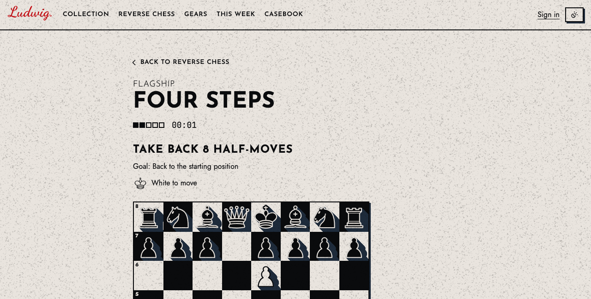
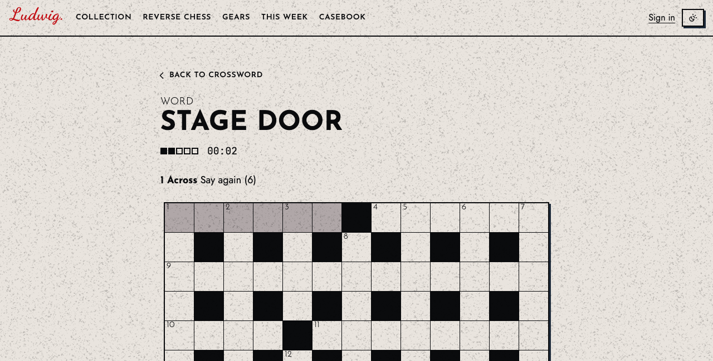
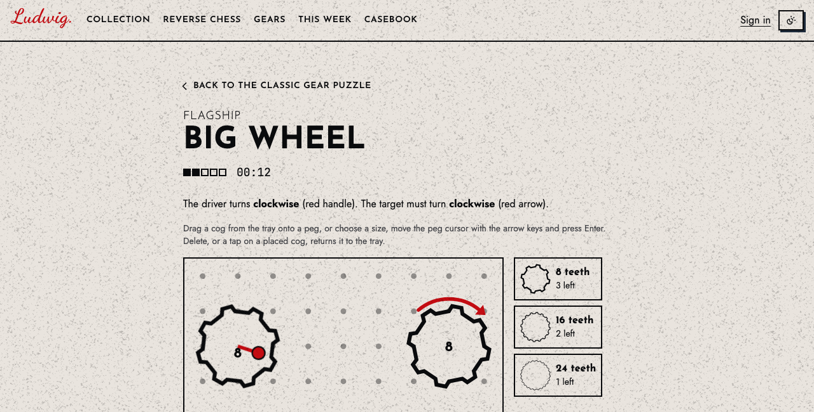

# T169 report: Audit the desktop solve page for every puzzle type

Status: DONE
Branch: ticket/T169-desktop-solve-layout-audit
Verify cycles: 1

Result: `docs/research/desktop-solve-layout.md` (the specification for T170). No file under `src/`, `content/` or `e2e/` changed.

## Summary table

| AC | Result | Method | Evidence |
|---|---|---|---|
| AC1 | PASS | cli | `pnpm tsx scripts/dev/audit-desktop-layout.mts` against `pnpm start --port 3169`: exit 0, last line `ROWS 140 (35 targets x 2 sizes x 2 states); registry types 34`, one row per type and viewport in `.verification/T169/table.md` |
| AC2 | PASS | code | measurements table (section 2) and a group for each of the 34 registry keys (section 4) |
| AC3 | PASS | code | section 5 names the panel elements in order per type, section 6 the growing parts and test puzzles |
| AC4 | PASS | code | section 3: height of every chrome block (identical at both sizes), the recommendation and the 636px and 486px budget; section 7 gives each type's board size |
| AC5 | PASS | code | `gears` and `spot-difference` are `excluded`; `gear-train`, `reverse-chess`, `chess-problem`, `crossword` are `panel` |
| AC6 | PASS | browser | 140 screenshots in `.verification/T169/` (`<key>-<w>x<h>-<open\|solved>.png`); embedded in the document: `docs/research/desktop-solve-layout/reverse-chess-unwind-1280x650-open.png`, `crossword-1280x650-open.png`, `gear-train-1280x650-open.png` |
| AC7 | PASS | code | T170's type list, board-size floors, test puzzles and AC10 grep changed to match; it names the document as its specification. `git diff --stat origin/main...HEAD` shows only `docs/` and `scripts/dev/` |
| AC8 | PASS | cli | `pnpm ticket:gates` → `GATES PASS (7 steps, 47s)` |

## Gates

typecheck ✔ · lint ✔ · test ✔ · build ✔ · puzzles:verify ✔ (`pnpm ticket:gates`) · e2e skipped (docs and `scripts/dev` only)

## Evidence

- Counts: 35 targets (34 registry types, Reverse Chess in `last_move` and `unwind`), 70 open rows and 70 solved rows. The content has no proof-game puzzle.
- Every type overflows at both sizes today (smallest: anagram, 12px at 1440×800).
- Chrome: 310px above the solver, 112px below, 296px solved footer; recommended title bar gives a board column of `100dvh − 164px` (636px, 486px).
- Sweep (`--sweep`): all 265 published puzzles except spot-difference at 1280×650; largest per type is in section 2 of the document. `--grown` measured the 14-ply `unwind` chain (1944px page with all plies entered) and the crossword clue lists (576px Across list at `fine-print`).

### AC6

## Deviations and follow-ups

- **Departures from T170's expectations, all written into T170:** the grid-only types it called probably board-only (`nonogram`, `norinori`, `star-battle`, `circle9`, `railroad`, `reflections`, plus `fillomino`, `troix`) go in the shared shell with a rail, because one column leaves a board of about 314px at 1280×650; only `anagram` and `odd-one-out` are `board-only`; `word-search` also has its own `md:flex-row` split; `SolveSlot` is not suitable for the panel (post-hydration portal, leaves `inert`); the board caps (`cellRem`, `max-w-xl`, `max-w-lg`) must be lifted to reach the sizes.
- **Solved state was measured with a completion row in the DB** (signed in) rather than by solving each type, so no epilogue is included; epilogue heights are estimated from content in the document.
- Production-mode `pnpm start` does not verify sign-ups on creation (that is preview and dev only), so the script marks its throwaway user verified in the local database.
- No SPEC change (T170 owns §4.5).
